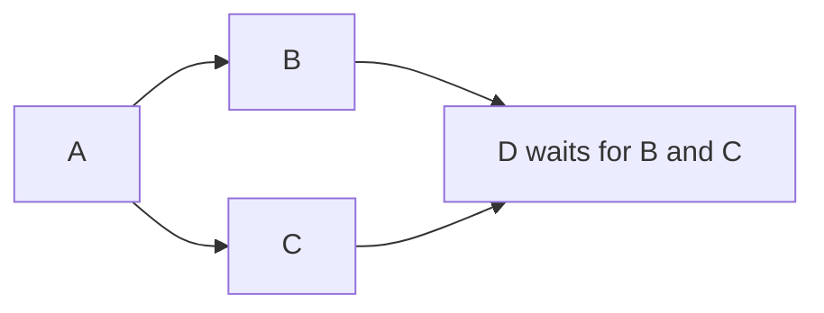

# Design

## Validation and data

The API rejects cycles, missing parents, duplicate IDs, and invalid references before database transactions.
`api/storage.py` commits each accepted submission or trigger atomically.
References can read ancestor outputs. Whole-value data references keep JSON types. References inside strings become text.
The orchestrator resolves and freezes inputs before dispatch, so retries use the same data.

Redis can carry the full task JSON as a serialized string. Its [default string limit is 512 MB](https://redis.io/docs/latest/develop/data-types/strings/#limits).
This engine defaults to 256 KiB per ordinary node value and 8 MiB for aggregate data.
Compose caps Redis memory at 256 MiB, so smaller application limits control memory use and latency.

## API idempotency

`POST /workflow` accepts an optional `Idempotency-Key`. Without it, each accepted request creates a new execution.
For a supplied key, a PostgreSQL advisory lock serializes concurrent requests across API replicas. The workflow and unique key mapping commit together.

A repeated key returns the original `execution_id` and `201`, even with different valid content. Each request still passes validation before the key lookup.
Retention deletes the key with its execution.

`POST /workflow/trigger/{identifier}` accepts one trigger under an execution row lock. Further valid triggers return `409`.
After a lost response, a client can read status before another trigger request. GET requests do not start work.

## Readiness and fan-in

The orchestrator makes root nodes ready after a workflow start event.
Before it applies a completion, it locks the execution row with `SELECT ... FOR UPDATE`. This serializes state decisions across orchestrator replicas.
One SQL statement marks a child ready only when all parents are `COMPLETED`.

If B finishes first, D stays pending until C completes. The final parent completion marks D ready and creates its try and task outbox record in one transaction.
The `state='PENDING'` and `reason='READY'` guard, unique try/outbox keys, and applied-event markers prevent duplicate dispatches for that try.
The row lock serializes state changes. Handlers and other executions can run in parallel.

## Atomic node claims

A Redis claim acts as the lock for one node try. Workers use Redis only.
Each claim is scoped to the task stream and `(execution_id, node_id, try_number)`.
[worker/broker.py](worker/broker.py) uses one Lua script for the absence test and claim creation. Redis runs the script without interleaved client commands.

1. If the execution deadline elapsed or a claim exists, Redis returns no claim.
2. Otherwise, Redis creates a claim and a `started` event in the same atomic operation.
3. The worker starts the handler only after a successful claim and while its lease remains valid.

The claim contains an owner token and handler lease. Two workers cannot both receive a claim for the same try.
The loser acknowledges the message and skips the handler. Separate nodes and tries keep separate keys, so branches remain parallel.

The claim expires three seconds after the execution deadline. An expired handler lease does not release the same try.
A retry uses a new try number and claim key.

## Results and recovery

Only the current owner can store the first result within its lease. Redis stores a result digest, so identical retries succeed without another notification.
A different result or owner token is rejected. Report retries reuse immutable JSON.

The orchestrator saves accepted results and workflow changes in one database transaction. It then removes the cached report and acknowledges the event.
The execution row lock protects aggregate output budgets. Current-try and owner-token guards prevent stale reports from changing a newer try.

Triggers and task dispatches commit with outbox records. The orchestrator can repeat publication after a crash without a new logical task.

Recovery examines Redis lease time and saved results before a timeout. On-time results can survive notification delay.
Expired leases and retryable failures permit new tries, with three tries per node by default. Permanent failures block dependent nodes.
Redis uses persistent AOF with `appendfsync always` and no eviction. Outbox repair restores missing tasks and recovers saved worker reports.

Complete Redis data loss can repeat in-flight work. A crash before result storage can also repeat external effects across new tries.
Real providers need idempotency keys based on execution and node IDs.

Defaults permit four handlers per worker, eight reserved tasks per execution, and three concurrent control events.
Coroutines overlap I/O. CPU pools permit two processes and four admitted jobs.
Upload, graph, value, queue, and execution limits bound resource use.

## Trade-offs

| Decision | Benefit | Cost or limit |
|---|---|---|
| Submission key in PostgreSQL | API replicas return one durable receipt. | Keys expire with workflow retention. |
| PostgreSQL and outbox | Accepted definitions and triggers survive application crashes and broker loss. | Transactions and repair add database work. |
| Redis claim per node try | Workers use Redis only. Parallel tasks keep separate claims. | Total Redis loss weakens duplicate protection. |
| PostgreSQL row lock per execution | Fan-in stays correct across replicas. | State changes within one execution serialize. Handlers remain parallel. |
| Bounded pools and admission | CPU work and queues stay limited. | Processes add overhead. Overload returns `429` or `503`. Native snapshots can briefly pause the loop. |
| Local API rate limits | Each process bounds request rates. | A deployment-wide limit needs a shared gateway. |

Shared PostgreSQL and Redis capacity limits total throughput as replicas increase.
